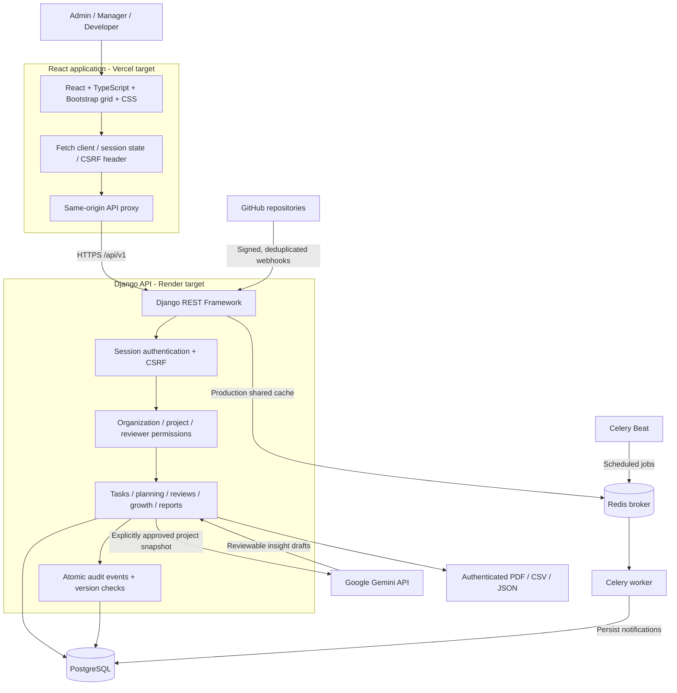

# SprintLens

**Developer activity, project delivery, audits and growth in one workspace.**


## What it does

SprintLens helps teams track delivery, surface blockers and review engineering work with context. Managers assign tasks and review progress; developers submit updates, report dependencies and respond to feedback. Administrators manage accounts and project access.

- Projects, task assignment, deadlines, milestones, sprints and dependencies.
- Work updates, structured blockers and explicit project reviewer permissions.
- Audited changes, version conflict protection and organization-scoped access.
- Two-way reviews, evidence-based assessments and developer growth goals.
- Signed GitHub webhooks linking commits, pull requests and reviews to tasks.
- Explainable delivery analytics, a knowledge hub and private notifications.
- Consent-based Gemini project insights and authenticated PDF/CSV/JSON reports.

## Architecture



The backend is API-only. React owns application HTML, styling and interactions. PostgreSQL stores business records; Redis supports background jobs and production shared caching. Local development uses Django's in-memory cache. GitHub activity supplies evidence rather than an automatic performance score.

## Source layout

```text
frontend/
  src/components/       Screens, grouped navigation and dialogs
  src/hooks/            Session, workspace state and feature actions
  src/api.ts            API client, CSRF and pagination
  scripts/              Vercel routing generation and tests
backend/
  config/               Django settings, URLs, WSGI and Celery
  workspace/            Models, APIs, authorization and workflows
    migrations/         Database schema history
    tests/              Automated backend checks
    management/commands/ Setup and operational commands
  scripts/              Production build, release and start scripts
deploy/                 Render deployment template
docs/architecture.md    Concise architecture reference
```

## Local development

Prerequisites: Node.js/npm, Python with the backend dependencies, PostgreSQL, and Redis when running background jobs.

```powershell
# Backend: create a virtual environment and install dependencies
cd backend
python -m venv .venv
.\.venv\Scripts\python.exe -m pip install -r requirements.lock.txt
```

Configure your private local database settings before applying migrations. `local.py` loads the ignored `.local.json`; a new checkout does not contain the original machine's database or credentials. Review `local_environment.py` for the local configuration schema. Production settings are documented in `backend/.env.example`; environment variables must be explicitly supplied, as this file is not auto-loaded.

```powershell
.\.venv\Scripts\python.exe local.py migrate
.\.venv\Scripts\python.exe local.py runserver 127.0.0.1:8000
```

```powershell
# Separate terminal
cd frontend
npm ci
npm run dev
```

Open `http://127.0.0.1:5173`. Accounts are administrator-managed; credentials are not distributed in the repository.

For local background jobs, start Redis with host port 6379 available, then use separate terminals in `backend/`:

```powershell
.\.venv\Scripts\python.exe local_jobs.py worker --pool=solo --loglevel=info
.\.venv\Scripts\python.exe local_jobs.py beat --loglevel=info
```

Run only one Beat scheduler. Linux workers are recommended for deployment.

## Verification

```powershell
# From backend/
.\.venv\Scripts\python.exe local.py test workspace --noinput
.\.venv\Scripts\python.exe local.py check

# From frontend/
npm run build
npm run test:production
```

## Deployment status

Vercel and Render are the planned hosting targets. Deployment templates and production checks are included; a live deployment is not claimed. Configure real HTTPS origins, secrets, PostgreSQL, Redis, worker and Beat services before deployment. Generate Vercel API routing with `frontend/scripts/configure-production.mjs` using the real backend origin.

GitHub webhook delivery requires a publicly reachable HTTPS backend. Gemini is optional, requires a server-side key and explicit data disclosure consent, and is subject to provider quotas and billing policies.

## Author

Created and maintained by **Mohammad Shazil Moin**.
