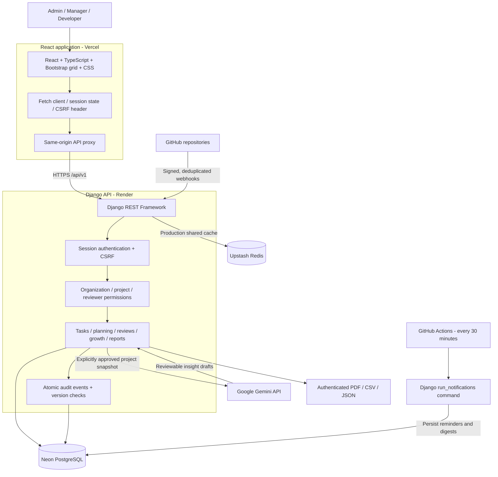
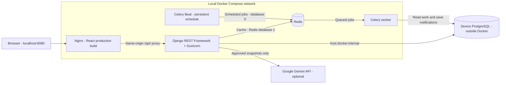

# SprintLens

**Developer activity, project delivery, audits and growth in one workspace.**

[](https://sprintlens-kohl.vercel.app/)
[](https://github.com/Shazil81/SprintLens/actions/workflows/production-notifications.yml)

**Live app:** [sprintlens-kohl.vercel.app](https://sprintlens-kohl.vercel.app/)

Access is managed by a workspace administrator. There is no public signup, and credentials are not published. The free backend may take about a minute to wake up after inactivity.


## What it does

SprintLens helps teams track delivery, surface blockers and review engineering work with context. Managers assign tasks and review progress; developers submit updates, report dependencies and respond to feedback. Administrators manage accounts and project access.

- Projects, task assignment, deadlines, milestones, sprints and dependencies.
- Work updates, structured blockers and explicit project reviewer permissions.
- Audited changes, version conflict protection and organization-scoped access.
- Two-way reviews, evidence-based assessments and developer growth goals.
- Signed GitHub webhooks linking commits, pull requests and reviews to tasks.
- Explainable delivery analytics, a knowledge hub and private notifications.
- Consent-based Gemini project insights and authenticated PDF/CSV/JSON reports.

## Architecture



The diagram above describes the live cloud deployment. Scheduled cloud jobs use GitHub Actions; Celery runs in the local Docker stack below.



The backend is API-only. React owns application HTML, styling and interactions. PostgreSQL stores business records. Docker uses Redis for caching and Celery jobs; native local development defaults to in-memory caching unless `CACHE_URL` is supplied. GitHub activity supplies evidence rather than an automatic performance score.

## Source layout

```text
frontend/
  src/components/       Screens, grouped navigation and dialogs
  src/hooks/            Session, workspace state and feature actions
  src/api.ts            API client, CSRF and pagination
  scripts/              Vercel routing generation and tests
backend/
  config/               Django settings, URLs, WSGI and Celery
  workspace/            Models, APIs, authorization and workflows
    migrations/         Database schema history
    tests/              Automated backend checks
    management/commands/ Setup and operational commands
  scripts/              Production build, release and start scripts
deploy/                 Render deployment template
docs/architecture.md    Concise architecture reference
compose.yaml            Complete local container stack; host PostgreSQL
compose.jobs.yaml       Alternative Redis / worker-only stack
```

## Local development

### Docker Compose

Prerequisites: Docker Desktop with the Linux engine running, and your device's PostgreSQL service running and reachable from Docker. PostgreSQL is not containerized or copied to Neon by this setup.

From the repository root, copy `.env.docker.example` to `.env.docker.local`, set a private Django secret and your local PostgreSQL connection details. Use `host.docker.internal` as the database host and URL-encode special characters in credentials. The private file is ignored by Git and must never be committed. Optional Gemini settings are also server-side in this file.

```powershell
if (!(Test-Path .env.docker.local)) { Copy-Item .env.docker.example .env.docker.local }
# Fill in .env.docker.local before starting; preserve it if already configured.
docker compose up --build -d
docker compose ps
docker compose logs -f
```

Open [localhost:8080](http://localhost:8080). Nginx serves the React build and proxies API requests to Django. Backend startup applies migrations to the configured local database before the dependent services start. Existing database accounts keep their passwords; a fresh database requires administrator account setup.

```powershell
# Stop the stack; retain Redis and Beat volumes
docker compose down
# Rebuild after code changes
docker compose up --build -d
# Check worker connectivity
docker compose exec worker celery -A config inspect ping
```

Only the frontend port is exposed, bound to localhost. Redis data and Beat schedule state use named volumes. Run one Beat scheduler; stop any native local worker/Beat processes when using this stack. `compose.jobs.yaml` is an alternative partial setup and should not run alongside the complete Compose stack. Local HTTP mode uses `DJANGO_DEBUG=1`; this Compose configuration is not an Internet-facing production deployment. Vercel/Render continue to use their existing deployment configuration.

### Native processes

Prerequisites: Node.js/npm, Python with the backend dependencies, PostgreSQL, and Redis when running background jobs.

```powershell
# Backend: create a virtual environment and install dependencies
cd backend
python -m venv .venv
.\.venv\Scripts\python.exe -m pip install -r requirements.lock.txt
```

Configure your private local database settings before applying migrations. `local.py` loads the ignored `.local.json`; a new checkout does not contain the original machine's database or credentials. Review `local_environment.py` for the local configuration schema. Production settings are documented in `backend/.env.example`; environment variables must be explicitly supplied, as this file is not auto-loaded.

```powershell
.\.venv\Scripts\python.exe local.py migrate
.\.venv\Scripts\python.exe local.py runserver 127.0.0.1:8000
```

```powershell
# Separate terminal
cd frontend
npm ci
npm run dev
```

Open `http://127.0.0.1:5173`. Accounts are administrator-managed; credentials are not distributed in the repository.

For local background jobs, start Redis with host port 6379 available, then use separate terminals in `backend/`:

```powershell
.\.venv\Scripts\python.exe local_jobs.py worker --pool=solo --loglevel=info
.\.venv\Scripts\python.exe local_jobs.py beat --loglevel=info
```

Run only one Beat scheduler. Linux workers are recommended for deployment.

## Verification

```powershell
# From backend/
.\.venv\Scripts\python.exe local.py test workspace --noinput
.\.venv\Scripts\python.exe local.py check

# From frontend/
npm run build
npm run test:production
```

## Deployment status

| Component | Hosting / status |
| --- | --- |
| Frontend | Live on Vercel with a same-origin API proxy |
| Django API | Live on Render |
| Database | Neon PostgreSQL |
| Shared cache | Upstash Redis |
| Authentication | Admin, Manager and Developer sign-in verified |
| GitHub integration | Real push delivery and persisted activity verified for a testing repository |
| Scheduled notifications | GitHub Actions at minutes 17 and 47; manual execution and a persisted deadline reminder verified |
| AI insights | Gemini live generation, approved evidence citations and saved output verified |
| Celery worker / Beat | Available for local or dedicated hosting; not running in the current cloud deployment |

The scheduled workflow calls the existing notification logic directly. GitHub schedules can be delayed; notification generation is deduplicated. This deployment is suitable for demos and evaluation; full workflow testing, backup/recovery planning and monitoring remain production readiness work.

GitHub webhook delivery requires a publicly reachable HTTPS backend. Gemini is optional, requires a server-side key and explicit data disclosure consent, and is subject to provider quotas and billing policies.

## Author

Created and maintained by **Mohammad Shazil Moin**.
